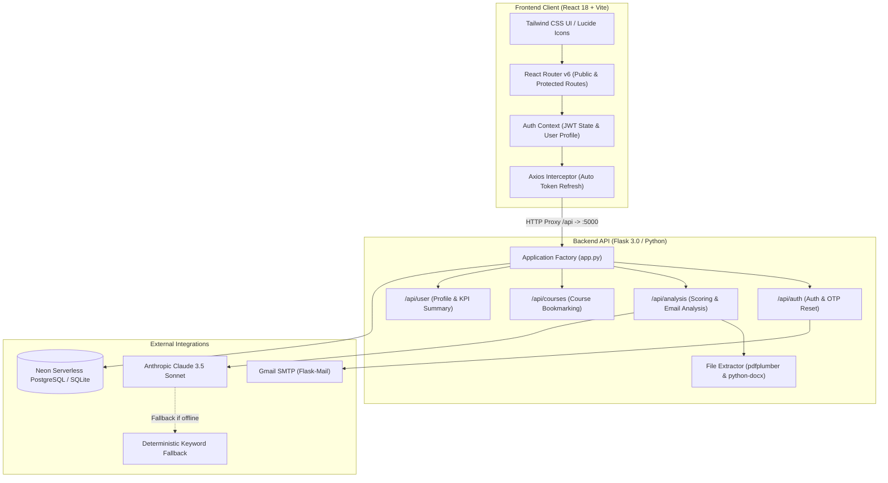

# SkillBridge 🚀

**An AI-Powered ATS Resume Analyzer, Skill-Gap Diagnostic & Career Readiness Platform**

[](https://react.dev/)
[](https://flask.palletsprojects.com/)
[](https://neon.tech/)
[](https://anthropic.com/)
[](LICENSE)

---

## 📖 Overview

**SkillBridge** bridges the gap between job seekers and corporate Applicant Tracking Systems (ATS). 

Candidates upload their resume (`.pdf`, `.docx`, or `.txt`) and paste a job description. The platform leverages **Anthropic's Claude 3.5 Sonnet** — backed by an automatic deterministic keyword-matching fallback engine — to generate:
- An **overall ATS match score** (0–100)
- Four **dimension scores**: Technical, Experience, Education, Soft Skills
- **Found skills** vs. **Missing skills**
- A **candid hiring verdict** and tailored, actionable tips referencing the candidate's exact background
- **Direct course recommendations** (Coursera, Udemy, freeCodeCamp, Kaggle, YouTube) categorized by level, duration, and pricing (free vs. paid) to bridge missing competencies.

---

## ✨ Features

- 🎯 **ATS Resume ↔ Job Description Matching:** Ingests PDF, DOCX, and text resumes with automatic cleanup and structured JSON scoring.
- 🛡️ **Fault-Tolerant AI Engine:** Automatically fails over to an internal keyword heuristic scorer if the Anthropic API key is omitted or rate-limited.
- 📚 **Curated Course Recommendations:** Recommends vetted free and paid courses for top missing skills.
- 📧 **Rejection Email Analyzer:** Evaluates response emails from recruiters to determine decision labels, confidence ratings, root causes, and recommended next steps.
- 📝 **Interactive Resume Builder:** Clean structured resume assembler with built-in improvement tips.
- 📊 **User Dashboard & Analytics:** Tracks historical analyses, average match score trends, saved course progress, and recurring skill gaps.
- 🔐 **Stateless JWT Security & OTP Reset:** Password hashing with salted bcrypt, access + refresh token rotation with Axios interceptors, and 10-minute OTP delivery via Gmail SMTP.
- 🐘 **Neon Serverless PostgreSQL:** Plug-and-play production database powered by Neon's serverless connection pooler.

---

## 🏗️ Architecture



---

## 🛠️ Tech Stack

### Frontend
- **Framework:** React 18
- **Build Tool:** Vite 5
- **Routing:** React Router DOM v6
- **Styling:** Tailwind CSS, PostCSS, Autoprefixer
- **HTTP Client:** Axios (configured with request and response interceptors for silent token refresh)
- **Icons & Alerts:** Lucide React, react-hot-toast

### Backend
- **Framework:** Flask 3.0
- **ORM:** SQLAlchemy (Flask-SQLAlchemy)
- **Database:** Neon Serverless PostgreSQL (`psycopg` / `psycopg2-binary`) with SQLite dev fallback
- **Authentication:** Flask-JWT-Extended + bcrypt
- **AI Model:** Anthropic Claude 3.5 Sonnet (`anthropic` SDK)
- **Document Parsers:** `pdfplumber` (PDF text & tables), `python-docx` (Word processing)
- **Email Service:** Flask-Mail (SMTP TLS)

---

## 📂 Project Structure

```text
SkillBridge/
├── Backend/
│   ├── app.py                  # App factory, blueprints, database config
│   ├── model.py                # SQLAlchemy models (User, Analysis, SavedCourse, EmailAnalysis)
│   ├── models.py               # Module re-export shim
│   ├── mail_config.py          # Flask-Mail configuration
│   ├── requirements.txt        # Backend dependencies
│   ├── .env.example            # Backend environment template
│   ├── routes/
│   │   ├── auth.py             # Signup, login, token refresh, OTP password reset
│   │   ├── analysis.py         # Resume scoring, email feedback, resume builder
│   │   ├── courses.py          # Saved course management & tracking
│   │   └── user.py             # User profile, password updates, dashboard KPIs
│   └── utils/
│       ├── analyzer.py         # Claude prompt logic & ATS keyword fallback
│       ├── courses_db.py       # Curated repository of courses mapped to skills
│       ├── file_parser.py      # PDF, DOCX, and TXT extractors
│       └── text_cleaner.py     # String sanitization helpers
├── Frontend/
│   ├── src/
│   │   ├── components/         # AppLayout, CourseCard, ScoreRing, etc.
│   │   ├── context/            # AuthContext (JWT management), ThemeContext
│   │   ├── pages/              # Dashboard, Analyze, ResumeBuilder, EmailInsights, Courses, Profile
│   │   ├── utils/              # Axios instance configured with interceptors
│   │   ├── App.jsx             # Route definitions & guards
│   │   └── main.jsx
│   ├── package.json
│   ├── vite.config.js
│   ├── tailwind.config.js
│   └── .env.example
├── neon.ts                     # Neon project & branch configuration
├── run.bat                     # 1-Click desktop launcher (starts both servers)
├── .gitignore
└── README.md
```

---

## ⚡ Getting Started

### Prerequisites
- **Python:** 3.10+
- **Node.js:** 18+
- **npm:** 9+

---

### 1-Click Launch (Windows)

Simply double-click the included launcher:
```powershell
run.bat
```
This automatically activates the backend virtual environment, starts Flask on port `5000`, starts Vite on port `3000`, and opens `http://localhost:3000` in your browser.

---

### Manual Setup

#### 1. Backend Setup (`localhost:5000`)
```powershell
cd Backend

# 1. Create and activate a virtual environment
python -m venv .venv
.\.venv\Scripts\activate      # On macOS/Linux: source .venv/bin/activate

# 2. Install dependencies
pip install -r requirements.txt

# 3. Configure environment variables
copy .env.example .env        # On macOS/Linux: cp .env.example .env

# 4. Start the API server
python app.py
```
> Verify health check: [http://127.0.0.1:5000/api/health](http://127.0.0.1:5000/api/health)

#### 2. Frontend Setup (`localhost:3000`)
Open a second terminal window:
```powershell
cd Frontend

# 1. Install dependencies
npm install

# 2. Configure environment
copy .env.example .env        # On macOS/Linux: cp .env.example .env

# 3. Start development server
npm run dev
```
Open **[http://localhost:3000](http://localhost:3000)** in your browser.

---

## 🔑 Environment Variables Reference

Edit `Backend/.env` to configure features:

| Variable | Required | Description |
| :--- | :---: | :--- |
| `DATABASE_URL` | No | Defaults to `sqlite:///skillbridge.db`. Set to Neon/Postgres pooler URI for cloud database. |
| `JWT_SECRET_KEY` | Yes | 64-character secret key used to sign JWT access tokens. |
| `SECRET_KEY` | Yes | Flask session encryption key. |
| `ANTHROPIC_API_KEY` | No | Anthropic API key for Claude 3.5 Sonnet. If empty, the app defaults to internal ATS keyword scoring. |
| `ANTHROPIC_MODEL` | No | Defaults to `claude-3-5-sonnet-latest`. |
| `EMAIL_USER` | No | Gmail address for OTP delivery. |
| `EMAIL_PASS` | No | 16-character Gmail App Password. |
| `FLASK_PORT` | No | Defaults to `5000`. |

---

## 🔌 API Endpoints Summary

### Authentication (`/api/auth`)
- `POST /api/auth/signup` — Create account, returns JWT access and refresh tokens.
- `POST /api/auth/login` — Authenticate user and issue tokens.
- `POST /api/auth/refresh` — Exchange refresh token for fresh access token.
- `GET /api/auth/me` — Retrieve current authenticated user profile.
- `POST /api/auth/forgot-password/request-otp` — Generate and email 6-digit OTP code.
- `POST /api/auth/forgot-password/verify-otp` — Verify OTP code validity.
- `POST /api/auth/forgot-password/reset` — Reset password using verified OTP.

### Analysis & Tools (`/api/analysis`)
- `POST /api/analysis/analyze` — Upload resume (or paste text) + job description; returns dimensional scores & course recs.
- `GET /api/analysis/history` — Fetch user's previous 20 resume analyses.
- `GET /api/analysis/<id>` — Retrieve full details of an analysis by ID.
- `DELETE /api/analysis/<id>` — Delete saved analysis.
- `POST /api/analysis/email-feedback` — Sentiment heuristic classification for rejection/acceptance emails.
- `GET /api/analysis/email-history` — Retrieve history of email analyses.
- `POST /api/analysis/build-resume` — Plain-text formatted resume generation.

### Courses (`/api/courses`)
- `GET /api/courses/` — List user's bookmarked courses.
- `POST /api/courses/` — Bookmark course from analysis recommendations.
- `PATCH /api/courses/<id>/complete` — Toggle completion status.
- `DELETE /api/courses/<id>` — Remove bookmarked course.

### Dashboard (`/api/user`)
- `GET /api/user/profile` — Fetch full candidate profile.
- `PUT /api/user/profile` — Update candidate profile details.
- `PUT /api/user/change-password` — Change password.
- `GET /api/user/dashboard-summary` — Aggregated KPI metrics (average match score, top recurring missing skills, recent reports).

---

## 🚀 Production Deployment Checklist

1. **Database:** Connected to Neon PostgreSQL pooler with SSL mode (`sslmode=require`).
2. **Server:** Serve Flask backend using Gunicorn with multi-threaded workers:
   ```bash
   gunicorn -w 4 -b 0.0.0.0:5000 app:app
   ```
3. **Frontend:** Run `npm run build` inside `Frontend/` and serve static files via Nginx, Vercel, or Cloudflare Pages.
4. **CORS:** Update `origins` in [Backend/app.py](file:///c:/Users/HP/Downloads/analyzer-master/analyzer-master/Backend/app.py) from `*` to your production domain.

---

## 👤 Author

Developed by **[Harsh Damani](https://github.com/harshdamani444-droid)**  
GitHub: [@harshdamani444-droid](https://github.com/harshdamani444-droid)
